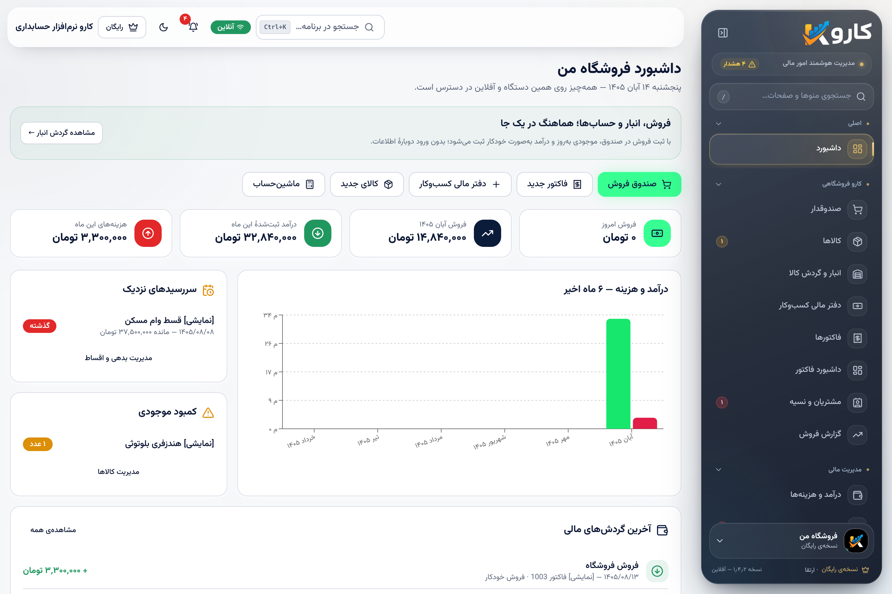

# راهنمای ورود تازه‌وارد — کارو

این سند برای کسی است که تازه به پروژه اضافه شده: در ۵ دقیقه بفهمد این برنامه
چیست، الان کجاست، و از کجا شروع کند.

## ۱) کارو چیست؟

**کارو نرم‌افزار حسابداری** یک اپ فارسی و راست‌به‌چپ برای کسب‌وکارهای کوچک است:
فروش و انبار، فاکتور، مشتریان و فروش نسیه، درآمد/هزینه، حقوق و دستمزد، و
ابزارهای محاسباتی. برند پیشین آن «حساب‌یار» بود؛ همه‌چیز حالا با نام **کارو**
منتشر می‌شود (نام داخلی و شناسه‌های فنی مثل `ir.karensoft.hesabyar` عمداً
تغییر نکرده‌اند تا آپدیت کاربران فعلی نشکند).



## ۲) دو نسخه از یک رابط کاربری

|        | نسخهٔ آفلاین (اصلی)                    | نسخهٔ سروری (تازه)                      |
| ------ | -------------------------------------- | --------------------------------------- |
| پوشه   | `src/`                                 | `laravel-backend/`                      |
| اجرا   | PWA در مرورگر + اپ اندروید (Capacitor) | وب روی هاست با PHP                      |
| داده   | Dexie/IndexedDB روی خود دستگاه         | دیتابیس MySQL/SQLite روی سرور           |
| ورود   | لایسنس آفلاین (کلید KS1)               | ایمیل/رمز + نشست لاراول                 |
| نقش‌ها | تک‌کاربرهٔ محلی                        | `manager` (مدیر کل) و `store` (فروشگاه) |
| شبکه   | بدون نیاز به اینترنت                   | نیازمند سرور                            |

هر دو **همان UI** را دارند؛ تفاوت فقط در «لایهٔ داده» و «احراز هویت» است.

## ۳) چه اتفاقی افتاده است (خلاصهٔ تاریخ)

1. **تغییر برند به کارو** — لوگو، آیکون‌ها، فونت، متن‌ها و نام بسته
   (`karo-accounting`) به‌روزرسانی شدند و دامنهٔ `karo.karen-soft.ir` ثبت شد.
2. **بک‌اند Laravel** — یکی از همکاران (`adding_laravel`) یک بک‌اند کامل
   نوشت: ورود با نشست، نقش مدیر/فروشگاه، صدور لایسنس، و API همگام‌سازی.
3. **یکپارچه‌سازی (PR باز #33)** — آن بک‌اند به `main` آورده شد و کپی
   فرانت‌اندش با نسخهٔ روز کارو بازسازی شد؛ حالا نسخهٔ سروری هم برند کارو را
   دارد و «کپیِ کهنه» نیست.
4. **همگام‌سازی حرفه‌ای‌تر** — به‌جای خواندن کل داده در هر بار، فقط تغییرات
   جابه‌جا می‌شوند (`rev`/`since`)، حذف‌ها هم به دستگاه‌های دیگر می‌رسند، و اگر
   دو دستگاه هم‌زمان یک ردیف را عوض کنند «تعارض» گزارش می‌شود نه بازنویسی.
5. **مهاجرت داده** — کاربر قدیمی از اپ آفلاین فایل پشتیبان JSON می‌گیرد و در
   تنظیمات نسخهٔ سروری بارگذاری می‌کند؛ ردیف‌ها با همان شناسه‌ها منتقل می‌شوند.
6. **بستهٔ استقرار** — یک ZIP آماده برای نصب روی cPanel ساخته می‌شود
   (`deploy/laravel-app/artifacts/karo-laravel.zip`) با راهنمای گام‌به‌گام.

> **الان کجا هستیم؟** `main` نسخهٔ آفلاین و پایدار است. کارِ نسخهٔ سروری در
> شاخهٔ `arena/3b615d22-karenyar` و **PR #33** است که هنوز مرج نشده؛ CI آن
> (هم‌خوانی فرانت‌اند، typecheck، vitest و Pest) سبز است. دامنهٔ
> `karo.karen-soft.ir` هنوز به GitHub Pages نرسیده و پاسخ cPanel می‌دهد.

## ۴) نقشهٔ پوشه‌ها

| مسیر                                | چیست                                                            |
| ----------------------------------- | --------------------------------------------------------------- |
| `src/`                              | کل رابط کاربری و منطق اپ آفلاین؛ نقطهٔ شروع برای هر تغییر UI    |
| `laravel-backend/`                  | بک‌اند Laravel + کپیِ تولیدشدهٔ فرانت‌اند در `resources/js`     |
| `laravel-backend/frontend-overlay/` | تنها فایل‌هایی که نسخهٔ سروری با `src/` فرق دارند (مرجع ویرایش) |
| `scripts/sync-laravel-frontend.mjs` | بازسازی `resources/js` از `src/` + overlay                      |
| `scripts/build-laravel-package.py`  | ساخت ZIP استقرار لاراول                                         |
| `scripts/build-web-archive.py`      | ساخت ZIP استقرار استاتیک (cPanel/GitHub Pages)                  |
| `scripts/assets/karo-logo.png`      | منبع رسمی لوگو؛ همهٔ آیکون‌ها از آن ساخته می‌شوند               |
| `docs/`                             | مستندات (دامنه، cPanel، امنیت، یکپارچگی لاراول، برندینگ)        |
| `deploy/`                           | بسته‌ها و راهنماهای استقرار                                     |
| `android/`، `admin-android/`        | پروژه‌های Capacitor اندروید (اپ مشتری و اپ مدیر)                |

## ۵) از کجا شروع کنم؟

**اجرای اپ اصلی (آفلاین):**

```bash
npm ci
npm run dev            # http://localhost:5173
npm test               # ۳۶۹ تست
npm run typecheck && npm run lint
```

**اجرای نسخهٔ سروری:**

```bash
cd laravel-backend
composer install && cp .env.example .env && php artisan key:generate
touch database/database.sqlite && php artisan migrate --seed
npm ci && npm run dev      # در ترمینال اول
php artisan serve          # در ترمینال دوم → http://127.0.0.1:8000
php artisan test           # ۲۲ تست Pest
```

## ۶) سه قاعده که اگر بلد نباشید دردسر می‌سازد

1. **`laravel-backend/resources/js` را دستی ویرایش نکنید.** این پوشه
   تولیدشده است: `src/` + `frontend-overlay/`. تغییر مشترک را در `src/`
   بدهید، تغییر مخصوص نسخهٔ سروری را در `frontend-overlay/`، و بعد:
   ```bash
   npm run sync:laravel-frontend      # بازسازی
   npm run check:laravel-frontend     # بررسی drift (CI هم اجرا می‌کند)
   ```
2. **لوگو/آیکون را با دست جایگزین نکنید.** `npm run icons:karo` همهٔ خروجی‌های
   وب/PWA/اندروید را از `scripts/assets/karo-logo.png` می‌سازد.
3. **`public/CNAME` را فراموش نکنید.** دامنهٔ GitHub Pages از همین فایل
   می‌آید؛ اگر پاک شود، سایت به آدرس پیش‌فرض `github.io` برمی‌گردد.

## ۷) چیزهایی که هنوز کار دارد

- **استقرار واقعی نسخهٔ سروری** روی `karo.karen-soft.ir` (بسته و راهنما آماده
  است؛ انجامش نیاز به دسترسی cPanel دارد).
- **صفحهٔ مرور تعارض‌ها** — الان سرور برنده است و کاربر ممکن است ویرایشش را
  از دست بدهد؛ UI برای دیدن/تکرار آن ساخته نشده.
- **همگام‌سازی آفلاین در نسخهٔ سروری** — نسخهٔ وبِ لاراول بدون اینترنت کار
  نمی‌کند (اپ اصلی آفلاین است).
- **تست بار** برای فروشگاه‌های با هزاران ردیف.
- **مهاجرت داده** فقط از فایل JSON است، نه مستقیم از IndexedDB مرورگر.
- تاریخچهٔ شاخهٔ لاراول یک کامیت با کپیِ پروژهٔ دیگر («amin gold») دارد که بعداً
  حذف شده؛ درخت نهایی پاک است ولی تاریخچه شلوغ است.

## ۸) مستندات مرتبط

- [`docs/laravel-integration.md`](laravel-integration.md) — معماری دو نسخه، sync، مهاجرت، استقرار
- [`laravel-backend/README.md`](../laravel-backend/README.md) — API و راه‌اندازی بک‌اند
- [`deploy/laravel-app/INSTALL.md`](../deploy/laravel-app/INSTALL.md) — نصب روی cPanel
- [`docs/domain-setup.md`](domain-setup.md) — اتصال دامنه به GitHub Pages
- [`docs/security-step-by-step.md`](security-step-by-step.md) — امنیت و لایسنس
- [`docs/branding/logo.md`](branding/logo.md) — برند و دارایی‌های بصری
